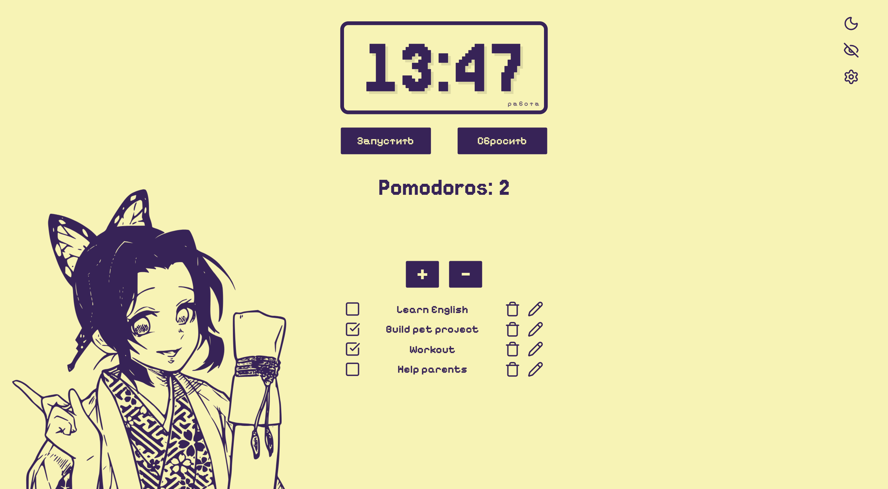

# React Pomodoro & Meditation Timer

[](https://echidnartem.github.io/pomodoro-timer/)

A lightweight productivity timer with Pomodoro, meditation, task management, local persistence, and configurable work sessions.

**Live demo:** [echidnartem.github.io/pomodoro-timer](https://echidnartem.github.io/pomodoro-timer/)



## Overview

React Pomodoro & Meditation Timer was created as a lightweight productivity application focused on distraction-free work and meditation, while also serving as practice for building maintainable React applications.

The project combines a focused timer interface with local task management, persistent user preferences, configurable timer presets, and a small set of reusable UI components and hooks. The application is intentionally client-side and stores its state in the browser, which keeps the experience simple and avoids external service dependencies.

## Key features

- **Pomodoro and Meditation modes:** switch between a work/break flow and a standalone meditation timer.
- **Configurable timer presets:** choose from 25/5, 45/10, and 52/17 work/break presets.
- **Custom timer settings:** set custom work, break, and meditation durations in minutes.
- **Task management:** add, edit, complete, delete, and clear tasks in Pomodoro mode.
- **Local persistence:** save timer state, tasks, theme, mode, and selected timer settings in `localStorage`.
- **Accurate countdown logic:** calculate remaining time from a `Date.now()` deadline so the timer stays correct after inactive tabs.
- **Cycle completion feedback:** play a local alarm sound when a timer cycle ends.
- **Document title updates:** show the remaining time and current status in the browser tab title.
- **Theme and mode styling:** apply light/dark themes and mode-specific color palettes through data attributes.
- **Keyboard control:** toggle the timer with the media play/pause key when the page receives the keyboard event.
- **Responsive interface:** adapt the layout for desktop and smaller screens.

## How it works

The timer state is split across focused custom hooks:

- `useTimer` owns the countdown state, active state, and deadline-based interval logic.
- `useTimerModes` restores the current mode state from `localStorage` or initializes a fresh timer for the selected mode.
- `useTimerPersistence` synchronizes the current timer state with `localStorage` and updates the browser tab title.
- `useTimerSettings` stores the selected timer preset or custom values and exposes the effective timer settings.
- `useTimerHotkey` listens for the media play/pause key and toggles the timer when the page receives that event.

When the timer starts, the application stores an absolute deadline calculated with `Date.now()`. Each interval tick compares the current time with that deadline instead of subtracting one second at a time. This keeps the countdown accurate even if the browser throttles timers in an inactive tab.

Timer progress is persisted per mode. The saved state also includes a settings key, so changing from one timer preset to another resets the current cycle duration while preserving the daily Pomodoro completion count.

## Technology stack

| Area | Technologies |
| --- | --- |
| Application | React 19, TypeScript, Vite |
| UI | Reusable React components, CSS files colocated with component folders |
| State and logic | React state, custom hooks |
| Persistence | LocalStorage API |
| Assets | Local fonts, local audio, SVG components via SVGR |
| Icons | Lucide React |
| Code quality | ESLint, TypeScript type checking |
| Deployment | GitHub Pages, `gh-pages` |

## Architecture

The project uses a modular React structure with a clear separation between application composition, reusable UI blocks, stateful hooks, shared utilities, and assets.

- `App.tsx` composes the application shell, theme toggle, mode toggle, settings popover, and timer.
- `components/` contains reusable UI components such as the timer display, controls, counter, task list, task item, and settings panel.
- `hooks/` contains stateful application logic for countdown timing, persistence, mode restoration, settings, and keyboard control.
- `utils/` contains framework-independent helper functions for formatting time, reading/writing `localStorage`, date handling, and alarm playback.
- `constants.ts` defines timer presets and settings helpers.
- `types.ts` centralizes shared TypeScript types used across the app.

The current structure is intentionally lightweight. It keeps related code easy to find without introducing a larger architectural pattern than the project needs.

## Installation and local development

### Requirements

- Node.js
- npm

### Setup

```bash
git clone https://github.com/echidnartem/pomodoro-timer.git
cd pomodoro-timer
npm install
npm run dev
```

After startup, Vite shows the local development URL in the terminal.

For a local production build preview:

```bash
npm run build
npm run preview
```

## Available scripts

| Command | Description |
| --- | --- |
| `npm run dev` | Start the Vite development server. |
| `npm run build` | Create a production build in `dist`. |
| `npm run lint` | Run ESLint across the project. |
| `npm run typecheck` | Run TypeScript checks without emitting files. |
| `npm run preview` | Preview the production build locally. |
| `npm run predeploy` | Build the project before deployment. |
| `npm run deploy` | Build and publish `dist` to GitHub Pages using `gh-pages`. |

## Deployment

The project is configured for GitHub Pages deployment.

Vite uses the `/pomodoro-timer/` base path in `vite.config.js`, and the deployment script publishes the generated `dist` directory:

```bash
npm run deploy
```

## Project structure

```text
.
|-- docs/
|   `-- images/                  # README screenshot
|-- public/                      # Static public assets
|   |-- bell.wav
|   |-- favicon-dark.svg
|   `-- favicon-light.svg
|-- src/
|   |-- assets/
|   |   |-- fonts/               # Local font files and @font-face rules
|   |   `-- image.svg            # Main SVG illustration imported through SVGR
|   |-- components/
|   |   |-- ControlButtons/      # Timer start/pause and reset/skip controls
|   |   |-- Counter/             # Pomodoro completion counter
|   |   |-- TaskList/            # Task list and editable task item
|   |   `-- Timer/               # Timer UI and settings panel
|   |-- hooks/                   # Timer, persistence, settings, and hotkey hooks
|   |-- utils/                   # Formatting, storage, date, and audio helpers
|   |-- App.css
|   |-- App.tsx
|   |-- constants.ts             # Timer presets and settings helpers
|   |-- index.css
|   |-- main.tsx
|   |-- types.ts
|   `-- vite-env.d.ts
|-- eslint.config.js
|-- index.html
|-- package.json
|-- tsconfig.json
`-- vite.config.js
```

## License

Distributed under the [MIT License](LICENSE).
